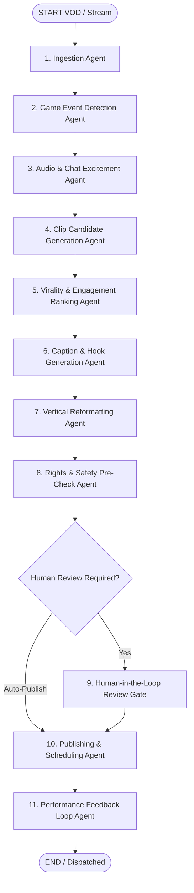

# CLUTCHCUT AI (PS-16)
### Autonomous Gaming Highlight Clipping & Publishing Agent

> **Domain:** Gaming & Esports Content  
> **Tech Stack:** Next.js (App Router, Turbopack, TypeScript), Node.js, `@langchain/langgraph`, `@langchain/core`, Vanilla CSS Design System, `lucide-react`.

---

## 🎮 Problem Statement Overview
Streamers and esports players spend hours manually scrubbing through 3–8 hour raw VODs just to find a single clutch moment to post on TikTok, YouTube Shorts, or Instagram Reels.

**CLUTCHCUT AI** functions as an autonomous 24/7 AI video editor who watches every frame, identifies the exact 15–25 seconds destined to trend, reframes horizontal 16:9 gameplay to vertical 9:16 with dynamic facecam overlays, creates viral hooks & subtitles, and publishes or queues clips based on algorithmic virality predictions.

---

## 🤖 10-Agent LangGraph Architecture

The system coordinates 10 specialized agent nodes via a compiled LangGraph `StateGraph`:



1. **Stream/VOD Ingestion Agent**: Chunks long-form VODs (10-minute analysis windows) and synchronizes game-event metadata feeds.
2. **Game Event Detection Agent**: Analyzes HUD, kill-feeds, player health (e.g. 3 HP remaining), spike defuse clocks, and clutch ratios (1v3 / 1v4).
3. **Audio & Chat Excitement Signal Agent**: Computes voice pitch (Hz), decibel spikes, Twitch chat message-rate acceleration (e.g. 8.4x baseline), and emote bursts (`PogChamp`, `W`, `KEKW`).
4. **Clip Candidate Generation Agent**: Applies intelligent boundary padding (context lead-in + peak payoff + reaction tail) without cutting mid-sentence.
5. **Virality & Engagement Ranking Agent**: Evaluates multidimensional virality factors (0–100 score) and categorizes S-Tier & A-Tier candidate packages.
6. **Caption & Hook Generation Agent**: Generates bold 1–2 second retention hooks (`"3 BULLETS. 1 v 3. GAME POINT. 💀"`) and speech-synced subtitles.
7. **Vertical Reformatting Agent**: Reframes 16:9 gameplay to 9:16 with center-of-action tracking, webcam/facecam picture-in-picture placement, and platform UI safe zones.
8. **Rights & Safety Pre-Check Agent**: Scans background audio against DMCA copyright databases and verifies brand safety and profanity grades.
9. **Publishing & Scheduling Agent**: Dispatches top clips immediately to YouTube Shorts & TikTok, and queues lower-priority clips for 7:00 PM peak-hour slots on Instagram Reels.
10. **Performance Feedback Agent**: Correlates actual retention curves with predicted virality scores to dynamically recalibrate signal weights for future sessions.
11. **Orchestrator Agent**: Manages the LangGraph state channels, handles error fallbacks, and halts at the human-in-the-loop review gate.

---

## 🌟 Advanced Features Implemented

1. **Live Clip-While-Streaming Mode**: Sub-minute clipper listening to live telemetry (chat velocity graph & streamer vocal pitch waveform) and publishing clips within 45 seconds of a live clutch play.
2. **Multi-Game Signal Adaptation**: Demonstrates cross-genre event detection for **Valorant** (killfeed cascade, 3 HP clutch), **Rocket League** (0-second overtime aerial ceiling pinch), **Counter-Strike 2** (1v4 eco deagle ace with 0.4s defuse), and **Apex Legends** (final ring squad wipe).
3. **Creator Style Memory**: Learned persona bank adjusting hook tone (`Hype & High Energy`, `Tactical Esports`, `Comedic Chaotic`), font typography, favorite keywords, and auto-publish virality thresholds.
4. **Before/After Clip Comparison**: Dual-screen player showing raw 16:9 unedited footage side-by-side with the final autonomous 9:16 vertical Short with speech-synced yellow subtitles and glowing hooks.
5. **Cross-Platform Performance Dashboard**: Multi-platform analytics comparing views, completion rates, and like ratios across Shorts, TikTok, and Reels with a 22-second retention dropoff curve.
6. **Rights & Safety Pre-Check**: Automatic DMCA audio copyright check and advertiser-safety verification.
7. **Auto-Generated Highlight Reel**: Compiles top clutch moments into a weekly compilation video complete with intro title drop, outro call-to-action, and chapter markers.

---

## 🚀 Running Locally

```bash
# Install dependencies (already installed)
npm install

# Start development server
npm run dev
```

Open `http://localhost:3000` in your browser.
